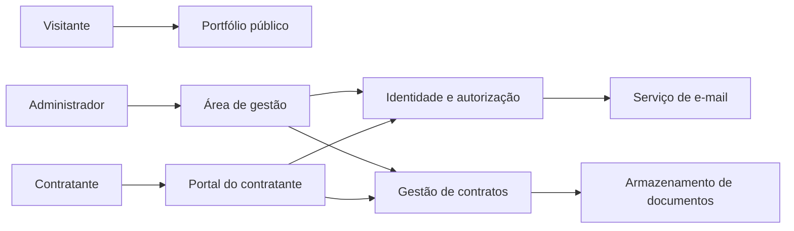
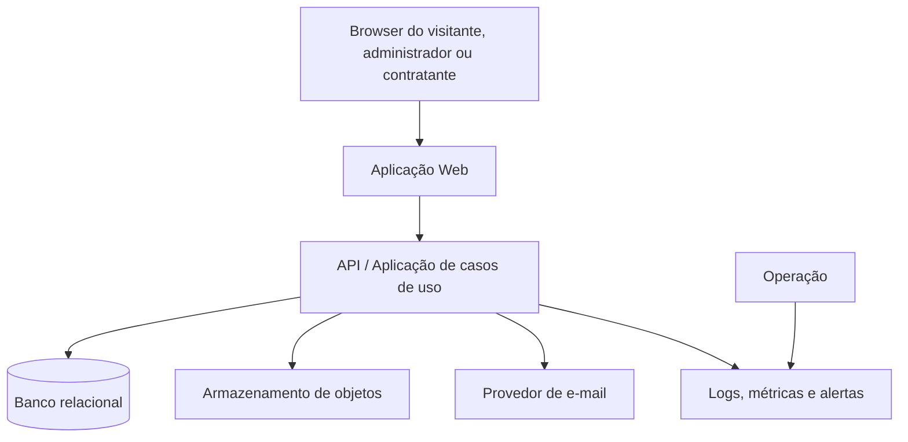

# Especificação Inicial — Portfólio Profissional e Gestão de Contratos

| Campo | Valor |
| --- | --- |
| Identificador | SRS-PORT-CON-001 |
| Versão | 0.3 (stack React/Python e upload de contrato assinado) |
| Data | 22 de outubro de 2026 |
| Estado | Em validação de requisitos |
| Proprietário | Responsável pelo portfólio (administrador) |
| Público | Administrador, contratantes, equipe de desenvolvimento e operações |
| Normas de referência | ISO/IEC/IEEE 29148:2018 (requisitos) e ISO/IEC/IEEE 42010:2022 (descrição de arquitetura) |

> Este documento está alinhado às estruturas das normas de referência; não constitui declaração de certificação de conformidade.

## 1. Propósito e escopo

O produto é um sistema web que combina:

1. um site público de apresentação profissional de um engenheiro de software; e
2. uma área autenticada para personalizar o perfil e administrar contratos de trabalhos freelancers.

O administrador publica e mantém informações do currículo, projetos, certificados, contatos e redes profissionais. Um contratante recebe convite por e-mail, cria sua própria senha por meio de um link de uso único e passa a acessar somente os contratos aos quais está vinculado.

O primeiro incremento inclui upload e gestão de contrato de prestação de serviços já assinado e recuperação de senha. Não inclui geração de contrato, coleta de assinatura eletrônica pelo sistema, emissão fiscal, cobrança/pagamento, marketplace de vagas, chat em tempo real ou gestão de uma equipe de freelancers. Esses temas podem ser integrados posteriormente sem alterar as regras centrais de perfil, identidade e contrato.

## 2. Contexto, objetivos e partes interessadas

### 2.1 Objetivos de negócio

- Apresentar competência profissional de modo confiável, acessível e personalizável.
- Centralizar a preparação, negociação, acompanhamento e encerramento de contratos freelancers.
- Reduzir comunicação dispersa sobre documentos e status de contratação.
- Oferecer ao contratante acesso seguro e limitado ao relacionamento contratual dele.

### 2.2 Partes interessadas

| Parte | Interesse e responsabilidade |
| --- | --- |
| Administrador/freelancer | Dona do perfil e dos contratos; configura conteúdo e concede acessos. |
| Visitante público | Consulta o portfólio, credenciais e formas de contato. |
| Contratante | Consulta, confirma recebimento e acompanha seus próprios contratos. |
| Operação do sistema | Mantém disponibilidade, backups, observabilidade e resposta a incidentes. |
| Desenvolvimento | Implementa, testa e evolui o produto dentro das fronteiras arquiteturais definidas. |

### 2.3 Premissas iniciais

- Há um único administrador do perfil no lançamento (papel `PROFILE_MANAGER`).
- Um contratante pode representar uma pessoa ou organização, mas possui **um único usuário de acesso individual** por convite no lançamento. Esse acesso serve à gestão do contrato e às validações de entregas.
- E-mail é o canal de entrega e verificação de convite e recuperação de senha. O primeiro adaptador usará SMTP do Gmail, mantendo a porta de e-mail substituível.
- O sistema recebe somente contrato de prestação de serviços já assinado. O formato aceito é PDF ou PDF/A, com tamanho máximo de 10 MB por arquivo.
- A validade jurídica da assinatura é responsabilidade do processo e do provedor utilizados fora do sistema. O produto armazena e controla o acesso ao arquivo recebido, sem gerar, executar, validar ou declarar a assinatura eletrônica.
- O sistema será disponibilizado em português (pt-BR); internacionalização é uma extensão planejável, não requisito da primeira entrega.

## 3. Visão do produto e limites



### Dentro do escopo

- Página pública com resumo profissional, experiências, competências, projetos, certificados, contatos e redes sociais.
- Conteúdo inicial fictício, claramente identificável e integralmente editável pelo administrador.
- Autenticação, recuperação/criação de senha via convite e controle de acesso por papel e vínculo contratual.
- Cadastro de contratantes, contratos, anexos, valores, datas, status e histórico de alterações.
- Convite e recuperação de senha por e-mail com token seguro, expiração e uso único.
- Upload, versionamento e acesso controlado ao contrato de prestação de serviços já assinado, em PDF/PDF-A de até 10 MB.
- Auditoria de ações relevantes e proteção de dados pessoais.

### Fora do escopo inicial

- Processamento de pagamento, PIX, boleto, nota fiscal e cálculo tributário.
- Geração de contrato, integração com provedor de assinatura, coleta/validação de assinatura eletrônica e custódia de evidências de assinatura.
- Edição simultânea de documentos, notificações por WhatsApp/SMS e aplicativo nativo.
- Múltiplos perfis públicos/tenants no mesmo produto.

## 4. Requisitos de sistema

### 4.1 Convenções

- `FR` identifica requisito funcional; `NFR`, requisito não funcional; `BR`, regra de negócio; `AC`, critério de aceitação.
- Prioridade: **M**ust (obrigatório para o MVP), **S**hould (importante, pode seguir em incremento subsequente) e **C**ould (desejável).
- Termos “deve” são obrigatórios; “pode” indica opção permitida.

### 4.2 Requisitos funcionais

| ID | Prioridade | Requisito | Critérios de aceitação resumidos |
| --- | --- | --- | --- |
| FR-01 | M | O sistema deve disponibilizar portfólio público sem autenticação. | AC-01: visitante visualiza dados publicados; AC-02: áreas de gestão não são expostas publicamente. |
| FR-02 | M | O administrador deve editar identidade profissional, resumo, experiências, competências, projetos, certificados, contatos e links sociais. | AC-01: alteração pode ser salva como rascunho; AC-02: somente conteúdo publicado aparece no site público. |
| FR-03 | M | O sistema deve fornecer conteúdo demonstrativo inicial e permitir removê-lo ou substituí-lo. | AC-01: conteúdo de exemplo é distinguível no painel; AC-02: nenhuma informação fictícia é obrigatória para publicação. |
| FR-04 | M | O administrador deve autenticar-se e encerrar sessão. | AC-01: credenciais válidas permitem acesso ao painel; AC-02: sessão encerrada perde acesso às rotas protegidas. |
| FR-05 | M | O administrador deve cadastrar e atualizar um contratante com nome, e-mail e tipo pessoa/organização. | AC-01: e-mail é validado; AC-02: duplicidade é tratada segundo BR-03. |
| FR-06 | M | O administrador deve criar, editar e consultar contratos vinculados a um contratante. | AC-01: contrato possui título, partes, valor/moeda, vigência e status; AC-02: apenas campos válidos permitem mudança de estado. |
| FR-07 | M | O administrador deve anexar um contrato de prestação de serviços já assinado ao contrato registrado no sistema. | AC-01: apenas PDF/PDF-A de até 10 MB é aceito; AC-02: arquivo é associado a uma versão, tem integridade registrada e acesso respeita autorização do contrato. |
| FR-08 | M | O sistema deve enviar convite por e-mail ao contratante para criação de senha. | AC-01: e-mail contém URL com token; AC-02: o token não é armazenado em texto puro; AC-03: reenvio invalida o convite anterior. |
| FR-09 | M | O contratante convidado deve criar senha por link válido e autenticar-se depois. | AC-01: token expirado/usado é recusado; AC-02: senha atende à política definida; AC-03: conta é ativada somente após sucesso. |
| FR-10 | M | O contratante deve visualizar somente seu cadastro mínimo e contratos aos quais está associado. | AC-01: tentativa direta de acessar contrato alheio retorna negação; AC-02: documentos seguem a mesma restrição. |
| FR-11 | M | O sistema deve manter histórico de transições de status, convites e alterações sensíveis. | AC-01: evento registra ator, data/hora, tipo, recurso e resultado; AC-02: histórico não pode ser alterado pela interface. |
| FR-12 | S | O administrador deve filtrar contratos por contratante, status e período de vigência. | AC-01: filtros podem ser combinados; AC-02: resultado indica quando não há registros. |
| FR-13 | S | O contratante deve poder registrar ciência do contrato disponibilizado. | AC-01: registra data/hora e usuário; AC-02: ciência não equivale a assinatura jurídica. |
| FR-14 | S | O sistema deve notificar administrador sobre expiração de convite e proximidade do término do contrato. | AC-01: regra de antecedência é configurável; AC-02: falha de entrega é auditável. |
| FR-17 | M | Usuário deve solicitar recuperação de senha por e-mail e definir nova senha através de token temporário. | AC-01: a resposta não confirma se o e-mail possui conta; AC-02: token é de uso único, expira e invalida tokens anteriores; AC-03: a redefinição encerra sessões existentes conforme política de segurança. |
| FR-18 | M | O contratante deve acessar validações de entregas associadas a seus contratos e registrar aprovação ou solicitação de ajuste. | AC-01: cada validação referencia contrato e entrega; AC-02: decisão, comentário, ator e data/hora são auditados; AC-03: não há acesso a validações de outro contratante. |

### 4.3 Regras de negócio

| ID | Regra |
| --- | --- |
| BR-01 | Um contrato pertence a exatamente um contratante; um contratante pode ter muitos contratos. |
| BR-02 | Estados permitidos do contrato: `DRAFT`, `PENDING_CLIENT_ACCESS`, `UNDER_REVIEW`, `ACTIVE`, `COMPLETED`, `CANCELLED`, `ARCHIVED`. Transições inválidas devem ser recusadas e registradas. |
| BR-03 | O e-mail de uma conta é único, normalizado para comparação. A associação de vários representantes à mesma organização é uma extensão futura. |
| BR-04 | Convite é específico para o e-mail destinatário, é de uso único e expira. O prazo exato deve ser configurável; valor proposto: 72 horas. |
| BR-05 | A criação/redefinição de senha nunca revela se uma conta existe além do fluxo autorizado pelo token. Senhas são armazenadas exclusivamente como hash forte. |
| BR-06 | O contratante não pode criar, alterar, excluir ou baixar recursos de outro contratante, mesmo conhecendo identificadores internos. |
| BR-07 | A remoção de contrato ou documento após disponibilização deve ser lógica/arquivada, preservando rastreabilidade conforme política de retenção aprovada. |
| BR-08 | O sistema não deve afirmar que o upload, a visualização ou o registro de ciência constitui assinatura eletrônica ou confere validade jurídica ao documento. |
| BR-09 | Somente contratos de prestação de serviços já assinados podem ser enviados. Cada substituição deve criar uma nova versão, mantendo a anterior arquivada para rastreabilidade. |
| BR-10 | O upload deve validar formato PDF/PDF-A, tamanho máximo de 10 MB, nome seguro, integridade e resultado de varredura antimalware antes de disponibilizar o arquivo. |
| BR-11 | Dados do contrato, documentos assinados enviados, auditorias e validações de entrega devem permanecer pelo vínculo contratual e por 6 meses após o término de sua validade. Ao fim do prazo, devem ser eliminados ou anonimizados conforme política aprovada, exceto quando retenção superior for exigida por obrigação legal, defesa de direitos ou ordem válida. |
| BR-12 | Um pedido de recuperação de senha substitui tokens de recuperação anteriores do mesmo usuário. Esse fluxo não substitui a ativação inicial baseada em convite. |

### 4.4 Requisitos não funcionais

| ID | Categoria | Requisito verificável |
| --- | --- | --- |
| NFR-01 | Segurança | Todo tráfego externo deve usar HTTPS; cabeçalhos de segurança e proteção contra ataques web comuns devem ser configurados na borda. |
| NFR-02 | Segurança | Senhas devem usar algoritmo adaptativo de hash aprovado pela equipe de segurança (proposta: Argon2id). Tokens de convite devem ser gerados criptograficamente, persistidos como hash e comparados em tempo constante. |
| NFR-03 | Segurança | Autorização deve ser aplicada no servidor, em cada operação e download, independentemente de controles visuais do cliente. |
| NFR-04 | Privacidade | Dados pessoais devem ter finalidade documentada, minimização, controles de exportação/eliminação e política de retenção compatível com a LGPD, a ser validada juridicamente. |
| NFR-05 | Disponibilidade | Meta inicial: 99,5% de disponibilidade mensal, excluídas manutenções comunicadas. |
| NFR-06 | Desempenho | Em carga operacional prevista, 95% das respostas de leitura autenticada devem concluir em até 500 ms, excluindo transferência de anexos. Meta de página pública: LCP até 2,5 s em conexão móvel de referência. |
| NFR-07 | Acessibilidade | Interfaces devem buscar conformidade WCAG 2.2 nível AA: navegação por teclado, contraste, rótulos, foco e mensagens de erro perceptíveis. |
| NFR-08 | Confiabilidade | Backups devem ser automatizados, testados por restauração periódica e ter RPO/RTO definidos antes da produção. Valores inicialmente pendentes. |
| NFR-09 | Observabilidade | Falhas, eventos de autenticação, envio de e-mail e transições de contrato devem produzir logs estruturados sem segredos ou tokens. |
| NFR-10 | Manutenibilidade | Domínio e aplicação devem ser testáveis sem banco de dados, framework web, e-mail ou armazenamento real. |
| NFR-11 | Compatibilidade | Suportar as versões estáveis atuais de Chrome, Edge, Firefox e Safari, e layouts responsivos a partir de 320 px. |
| NFR-12 | Arquivos | O upload deve rejeitar arquivo fora de PDF/PDF-A, acima de 10 MB, corrompido ou reprovado na varredura antimalware; arquivos devem ser servidos com tipo seguro e somente após autorização. |
| NFR-13 | Retenção | A rotina de retenção deve identificar contratos encerrados há mais de 6 meses, aplicar a decisão documentada de exclusão/anonimização e produzir auditoria do resultado. |

## 5. Casos de uso prioritários

### UC-01 — Publicar perfil profissional

**Ator primário:** administrador. **Pré-condição:** usuário autenticado com `PROFILE_MANAGER`.

1. O administrador edita uma seção do perfil ou cria projeto/certificado.
2. O sistema valida o conteúdo e salva como rascunho.
3. O administrador visualiza prévia e solicita publicação.
4. O sistema publica uma versão, registra auditoria e torna o conteúdo disponível no site público.

**Exceções:** campos obrigatórios ausentes ou URL inválida impedem a publicação e apresentam erro associado ao campo. A falha não descarta o rascunho válido anterior.

### UC-02 — Convidar contratante e criar acesso

**Ator primário:** administrador; ator secundário: contratante.

1. Administrador cadastra contratante e solicita convite.
2. Sistema cria token aleatório, armazena apenas seu hash e registra expiração.
3. Sistema envia mensagem com URL de ativação, sem incluir senha ou dados contratuais sensíveis.
4. Contratante abre a URL, informa e confirma senha.
5. Sistema valida token, cria/ativa a conta, inutiliza o token e inicia sessão ou direciona para login.

**Exceções:** token expirado, já utilizado ou não encontrado retorna mensagem segura, registra o evento e orienta o usuário a solicitar novo convite ao administrador.

### UC-03 — Criar e disponibilizar contrato

**Ator primário:** administrador.

1. Administrador seleciona um contratante e cria contrato em `DRAFT`.
2. Preenche metadados e anexa versão documental.
3. Sistema valida dados obrigatórios e registra a versão.
4. Administrador disponibiliza o contrato; o sistema muda para `PENDING_CLIENT_ACCESS` ou `UNDER_REVIEW`, conforme o acesso do contratante, e registra a transição.
5. Contratante autenticado visualiza o contrato e, quando habilitado, registra ciência.

### UC-04 — Consultar contrato como contratante

**Ator primário:** contratante autenticado.

1. Contratante acessa a área privada.
2. Sistema recupera somente associações do usuário autenticado.
3. Contratante abre um contrato e, caso permitido, seu documento.
4. Sistema autoriza a operação por vínculo de domínio, registra acesso sensível quando exigido e entrega o recurso.

### UC-05 — Enviar contrato assinado

**Ator primário:** administrador.

1. Administrador cria ou atualiza o registro de contrato e seleciona o PDF/PDF-A já assinado.
2. Sistema valida tipo real do arquivo, tamanho máximo de 10 MB, integridade e resultado da varredura antimalware.
3. Sistema cria uma versão documental imutável, registra hash, responsável e data/hora do envio.
4. Administrador disponibiliza o documento ao contratante; o sistema aplica autorização de acesso e registra a alteração de estado.

**Exceções:** arquivo fora do formato, acima do limite, corrompido ou reprovado pela varredura é recusado sem criar versão disponível.

### UC-06 — Recuperar senha

**Ator primário:** administrador ou contratante.

1. Usuário informa e-mail na tela de recuperação.
2. Sistema responde de forma neutra e, para conta elegível, cria token temporário de uso único e envia link pelo SMTP configurado.
3. Usuário abre o link e define nova senha conforme política.
4. Sistema consome o token atomicamente, troca o hash da senha, invalida tokens anteriores e registra a ação.

## 6. Modelo de informação inicial

| Entidade | Atributos principais | Relações e invariantes |
| --- | --- | --- |
| `ProfessionalProfile` | nome, cargo, resumo, foto, localização, contato, status de publicação | Há um perfil ativo no MVP. |
| `Project` | título, descrição, tecnologias, período, URL, mídia, publicado | Pertence ao perfil; URL e mídia são opcionais. |
| `Certificate` | título, emissor, emissão, URL de credencial, imagem | Pertence ao perfil; credencial deve ser URL válida se fornecida. |
| `Experience` | organização, função, início, fim, descrição | Pertence ao perfil; fim não antecede início. |
| `ContactLink` | tipo, rótulo, URL/valor, visibilidade | Pertence ao perfil; não expor campos marcados privados. |
| `Contractor` | nome legal/exibido, tipo, e-mail de contato, estado | É associado a conta quando o convite é concluído. |
| `UserAccount` | e-mail, hash de senha, papel, estado, último acesso | E-mail único; nenhum segredo em texto puro. |
| `Contract` | título, escopo, valor, moeda, início, fim, estado | Pertence a um contratante e possui versões documentais. |
| `ContractDocumentVersion` | número, nome, local do arquivo, hash, enviada em | É imutável após disponibilizada. |
| `DeliveryValidation` | descrição, referência de entrega, estado, decisão, comentário | Pertence ao contrato e pode ser decidido pelo contratante vinculado. |
| `Invitation` | hash do token, e-mail, expira em, usada em, revogada em | Um token só pode ser consumido uma vez. |
| `PasswordRecovery` | hash do token, usuário, expira em, usada em, revogada em | Um token só pode ser consumido uma vez. |
| `AuditEvent` | ator, ação, recurso, data/hora, resultado, metadados mínimos | Apêndice de auditoria; não é editável pela aplicação. |

### Conteúdo fictício inicial personalizável

| Seção | Exemplo de mock |
| --- | --- |
| Cabeçalho | “Alex Morgan — Engenheiro(a) de Software Full-stack” |
| Resumo | “Desenvolve produtos web seguros e sustentáveis, com foco em experiência e qualidade.” |
| Projeto | “Painel de Operações — aplicação para acompanhamento de indicadores e fluxos internos.” |
| Certificado | “Cloud Foundations — Instituto Exemplo, 2025” |
| Rede | LinkedIn, GitHub e e-mail de demonstração (`contato@exemplo.dev`) |

O mock não deve usar foto, nome, experiência, certificados ou contatos de pessoa real sem autorização. Na primeira autenticação, o painel deve destacar que os exemplos precisam ser revisados antes da publicação.

## 7. Arquitetura de referência

### 7.1 Decisões e princípios

- **Stack definida:** frontend React com TypeScript e API Python com FastAPI. SQLite é a persistência do incremento local. Regras de negócio do servidor ficam em `backend/domain`, casos de uso em `backend/application`, HTTP em `backend/presentation`, persistência em `backend/infrastructure` e composição em `backend/config`. O frontend consome a API por adaptador HTTP.
- **Estado do desenvolvimento:** o incremento local persiste contratos fictícios, versões de PDFs e decisões de entrega. Login de gestor com sessão revogável e controle de cadastro, edição e publicação de certificados estão implementados. Gestão de contratos e certificados exige autorização no servidor. Personalização do perfil, acesso individual de contratantes, SMTP, recuperação de senha, antimalware, auditoria completa e retenção automatizada ainda são requisitos a implementar. A API exige modo de demonstração explícito e execução local.

- **Arquitetura monolítica modular.** É a fronteira mais leve que preserva a opção de trocar provedor de e-mail, banco e armazenamento sem custos prematuros de microsserviços.
- **Regra de dependência.** Dependências de código apontam para dentro: `presentation`, `infrastructure` e `config` dependem de `application`/`domain`; as camadas internas não conhecem frameworks, HTTP, ORM ou provedor de e-mail.
- **Vocabulário do domínio.** Usar `Contractor`, `Contract`, `Invitation`, `Profile` e `Publication`, evitando nomes técnicos vagos como `Manager`, `Data` ou `Utils`.
- **Interfaces pertencem à política.** Portas de repositório, clock, token, e-mail e arquivo são definidas em `application` quando atendem casos de uso; adaptadores externos as implementam.
- **Sem abstração ritual.** Criar uma porta somente para um detalhe variável, uma dependência externa ou uma fronteira que beneficie os testes.

### 7.2 Visão de contêineres (C4 simplificado)



Uma aplicação web pode servir frontend e API juntos ou separadamente; essa decisão é de implantação e não altera as camadas. Banco, provedor de objetos e e-mail são detalhes externos conectados por adaptadores.

### 7.3 Estrutura de módulos obrigatória

```text
src/
  domain/
    profile/            # entidades, value objects e regras invariantes
    contracts/
    identity/
  application/
    profile/            # casos de uso, DTOs e portas de entrada/saída
    contracts/
    identity/
  presentation/
    web/                # páginas, componentes, controllers, presenters e validação de borda
  infrastructure/
    persistence/        # ORM/migrations/adaptadores de repositório
    email/              # adaptador do provedor de e-mail
    storage/            # adaptador de anexos
    security/           # hash, sessão/token e adaptadores criptográficos
    observability/
  config/
    composition-root/   # ambiente, injeção de dependência e bootstrap
```

| Camada | Responsabilidade permitida | Não pode depender de |
| --- | --- | --- |
| `domain` | regras de negócio estáveis, entidades e value objects | framework, HTTP, banco, ORM, e-mail, UI |
| `application` | orquestrar casos de uso, transações, autorização de caso de uso e portas | controllers, componentes visuais, ORM/provedor concreto |
| `presentation` | traduzir HTTP/formulários para DTOs, apresentar respostas e acessibilidade de UI | detalhes de persistência e regras duplicadas de domínio |
| `infrastructure` | implementar portas e integrar serviços externos | decisões de negócio fora dos contratos de porta |
| `config` | compor implementações por ambiente | conter regras de domínio ou fluxo de negócio |

### 7.4 Fronteira de segurança e fluxo de convite

```mermaid
sequenceDiagram
  participant A as Administrador
  participant S as Sistema
  participant E as E-mail
  participant C as Contratante
  A->>S: Criar/reenviar convite
  S->>S: Gerar token; salvar somente hash + expiração
  S->>E: Enviar URL com token
  E->>C: Entregar convite
  C->>S: Abrir URL e definir senha
  S->>S: Validar hash, expiração, uso e e-mail
  S->>S: Criar hash da senha; consumir token
  S-->>C: Conta ativada
```

Requisitos de implementação do fluxo: URL em HTTPS; token de alta entropia; token nunca em logs, métricas ou mensagens; limitação de tentativas; invalidação atômica no consumo; e proteção contra enumeração de conta. O token deve chegar ao cliente somente na criação do convite/recuperação e não ser recuperável depois.

### 7.5 Autorização

| Ação | Visitante | Administrador | Contratante |
| --- | --- | --- | --- |
| Ler perfil publicado | Permitida | Permitida | Permitida |
| Editar/publicar perfil | Negada | Permitida | Negada |
| Gerenciar contratantes e convites | Negada | Permitida | Negada |
| Criar/alterar contrato | Negada | Permitida | Negada |
| Ler contrato próprio | Negada | Permitida | Permitida, se vinculado |
| Baixar documento próprio | Negada | Permitida | Permitida, se vinculado e disponibilizado |
| Validar entrega do contrato próprio | Negada | Permitida | Permitida, se vinculado |
| Consultar auditoria | Negada | Permitida | Negada |

O papel autoriza a categoria da ação; o vínculo `UserAccount → Contractor → Contract` autoriza o recurso específico. Ambos são obrigatórios para o contratante.

## 8. Interfaces externas e contrato de API inicial

### 8.1 Rotas web/API de referência

| Método e rota | Acesso | Finalidade |
| --- | --- | --- |
| `GET /` | Público | Renderizar perfil publicado. |
| `POST /auth/login` | Público | Iniciar sessão de administrador/contratante. |
| `POST /auth/logout` | Autenticado | Encerrar sessão. |
| `POST /auth/invitations/activate` | Token válido | Definir senha e ativar conta convidada. |
| `POST /auth/password-recovery-requests` | Público | Solicitar recuperação sem revelar existência da conta. |
| `POST /auth/password-recovery/activate` | Token válido | Definir nova senha e invalidar token. |
| `GET/PUT /admin/profile` | Administrador | Consultar e atualizar rascunho do perfil. |
| `POST /admin/profile/publish` | Administrador | Publicar rascunho validado. |
| `GET/POST /admin/contractors` | Administrador | Consultar e cadastrar contratantes. |
| `POST /admin/contractors/{id}/invitations` | Administrador | Criar ou reenviar convite. |
| `GET/POST /admin/contracts` | Administrador | Consultar e criar contratos. |
| `GET/PATCH /admin/contracts/{id}` | Administrador | Consultar/alterar contrato e transicionar estado. |
| `POST /admin/contracts/{id}/documents` | Administrador | Enviar nova versão de contrato já assinado em PDF/PDF-A de até 10 MB. |
| `GET /portal/contracts` | Contratante | Listar exclusivamente contratos vinculados. |
| `GET /portal/contracts/{id}` | Contratante | Ler contrato autorizado. |
| `POST /portal/contracts/{id}/acknowledgements` | Contratante | Registrar ciência, quando habilitada. |
| `GET /portal/contracts/{id}/delivery-validations` | Contratante | Consultar validações de entrega autorizadas. |
| `POST /portal/contracts/{id}/delivery-validations/{validationId}/decision` | Contratante | Aprovar ou solicitar ajuste em uma entrega. |

Os nomes e formatos exatos são uma proposta. A API deve retornar erros consistentes sem vazar existência de recursos não autorizados e usar DTOs próprios nas bordas; entidades de domínio e modelos do ORM não devem ser serializados diretamente.

### 8.2 Integrações

| Integração | Dados trocados | Controle |
| --- | --- | --- |
| Provedor de e-mail | destinatário, template, URL temporária, status de entrega | credenciais em cofre de segredos; adaptador `EmailGateway` |
| SMTP Gmail | convites, recuperação de senha e notificações | usar credencial de aplicação/segredo no cofre; nunca registrar senha SMTP ou URLs com token |
| Armazenamento de objetos | anexos contratuais e mídias do perfil | URLs assinadas ou download mediado após autorização; antivírus/tipo/tamanho a definir |
| Banco de dados | dados operacionais, auditoria e hashes | migrações versionadas, criptografia em repouso quando provida pela plataforma e backups |
| Observabilidade | logs, métricas e rastreamento técnico | mascarar PII e proibir tokens/senhas nos eventos |

## 9. Qualidade, testes e critérios de aceite

### 9.1 Estratégia de verificação

| Nível | Alvo | Exemplos |
| --- | --- | --- |
| Unitário | `domain` e `application` | transições de estado, expiração/uso único de convite, regra de escopo de contrato |
| Integração | adaptadores de infraestrutura | migrações, repositórios, envio de e-mail em sandbox, armazenamento com autorização |
| API/contrato | controllers e DTOs | códigos HTTP, validação, formato de erros e negação de acesso direto |
| E2E | jornadas críticas | publicação de perfil; convite→senha→login; contratante não acessa contrato de terceiro |
| Arquivos | validação e acesso | PDF/PDF-A válido, até 10 MB, varredura aprovada, hash preservado e acesso somente ao contratante vinculado |
| Segurança | autenticação/autorização e borda web | análise de dependências, testes de controle de acesso, limitação de tentativas e revisão OWASP |
| Acessibilidade | páginas públicas e privadas | teclado, foco, contraste, leitor de tela e formulários com erro |

Testes devem ser rápidos, independentes, repetíveis, autoavaliáveis e oportunos (F.I.R.S.T.). O núcleo não deve exigir rede para seus testes. Todo defeito corrigido em regra de domínio deve primeiro ganhar teste de regressão.

### 9.2 Definition of Done inicial

Uma funcionalidade está pronta quando: requisitos e critérios de aceite atendidos; testes proporcionais passam; autorização é verificada no servidor; falhas não expõem segredo/PII; logs de auditoria relevantes existem; interface cumpre o mínimo de acessibilidade; documentação de API e configuração é atualizada; e revisão de código confirma que dependências apontam para dentro.

## 10. Operação, implantação e configuração

- Docker: dois serviços (`frontend` React/Nginx e `backend` Python/FastAPI) na rede bridge `application`; persistência em volume `backend-data`. Somente o frontend publica porta em `compose.yaml`. O overlay explícito `compose.dev.yaml` publica o backend em loopback no host, ativa reload e documentação da API. O frontend usa `/api` por proxy interno para `backend:8000`.

- Ambientes mínimos: desenvolvimento, homologação e produção, com credenciais e dados segregados.
- Configuração por ambiente deve viver em `config` e variáveis/cofre de segredos; segredos não entram no repositório nem em arquivos de exemplo.
- Pipeline deve executar lint, testes, verificação de tipos, análise de dependências e migrações em ambiente controlado antes de produção.
- Arquivos contratuais devem ser PDF/PDF-A de até 10 MB e passar por varredura antimalware antes de serem disponibilizados.
- A configuração SMTP do Gmail deve permanecer em cofre de segredos, com monitoramento de entrega, limite de envio e procedimento de rotação/revogação da credencial.
- Deve existir tarefa de retenção que preserve dados durante o vínculo e por 6 meses após o término de validade; o resultado da eliminação/anonimização deve ser auditável.
- Backups, política de retenção, RPO e RTO dependem do provedor e devem ser aprovados antes do go-live.
- Deve existir procedimento de revogação de sessão, reenvio de convite e resposta a incidente de acesso indevido.

## 11. Riscos e decisões em aberto

| ID | Item | Impacto | Ação necessária |
| --- | --- | --- | --- |
| R-01 | Validade do documento enviado | Alto: o sistema não verifica juridicamente a assinatura já realizada fora dele. | Definir processo administrativo e jurídico que antecede o upload e manter a responsabilidade explícita nos termos de uso. |
| R-02 | Política de retenção/LGPD | Alto: prazo foi definido, mas base legal e exceções exigem validação. | Aprovar controlador, bases legais, canal do titular, eliminação/anonimização e DPA com fornecedores. |
| R-03 | Um único login por contratante | Médio: organizações podem precisar de substituição do representante. | Definir processo administrativo seguro para trocar o único usuário permitido. |
| R-05 | Stack e hospedagem | Médio: afeta custo, deploy e operações, não o núcleo. | Escolher tecnologia, provedor, região e orçamento. |
| R-05 | SMTP Gmail | Médio: limites e política de conta podem afetar a entrega. | Configurar conta operacional, segredo de aplicação, domínio/remetente e monitoramento. |
| R-06 | Idiomas e moeda | Baixo/Médio: afeta modelos e apresentação. | Confirmar atuação internacional e moedas permitidas. |

## 12. Rastreabilidade resumida

| Objetivo | Requisitos que o realizam | Casos de uso |
| --- | --- | --- |
| Apresentar profissionalmente | FR-01 a FR-04, NFR-06, NFR-07 | UC-01 |
| Personalizar conteúdo | FR-02, FR-03 | UC-01 |
| Proteger gestão | FR-04, FR-11, NFR-01 a NFR-04 | UC-01 a UC-04 |
| Gerir contratos | FR-05 a FR-07, FR-12 | UC-03 e UC-05 |
| Dar acesso seguro ao contratante | FR-08 a FR-10, FR-17, BR-03 a BR-06 | UC-02, UC-04 e UC-06 |
| Validar entregas | FR-18, BR-06 | UC-04 |

## 13. Glossário

| Termo | Definição |
| --- | --- |
| Administrador | Usuário responsável pelo perfil público e pela gestão de contratantes/contratos. |
| Contratante | Pessoa ou organização que contrata o profissional e recebe acesso restrito. |
| Convite | Credencial temporária de uso único para criar senha e ativar uma conta. |
| Contrato | Registro do acordo de trabalho e seus metadados, documentos e estado de ciclo de vida. |
| Contrato de domínio | Regra de negócio independente de HTTP, banco e framework. |
| Porta | Interface definida pela aplicação para comunicar-se com um detalhe externo. |
| Adaptador | Implementação de uma porta para um detalhe, como banco, e-mail ou storage. |
| PII | Informação pessoal identificável. |

## 14. Aprovações requeridas para a próxima versão

Antes de iniciar a implementação, o responsável pelo produto deve validar: identidade/marca e conteúdo real do perfil; processo de troca do único usuário do contratante; política legal de contratos enviados, privacidade e retenção; estados definitivos do contrato e das validações de entrega; procedimento externo de assinatura; credenciais/remetente SMTP Gmail; hospedagem; e metas operacionais RPO/RTO.

